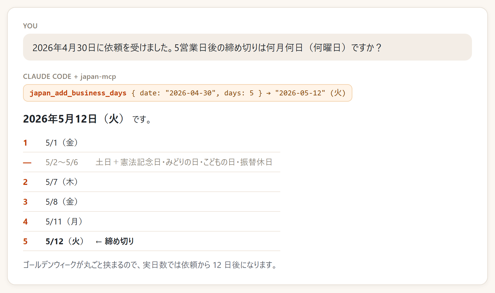

# japan-mcp

**Give your AI agent a Japanese calendar.** An MCP server for Japanese national holidays, business days (営業日) and era names (和暦).

- Offline — everything is computed locally. No network, no API keys.
- Holidays 1949–2099 from the rules of the law, including 振替休日, 国民の休日, the 2019 enthronement and the 2020/2021 Olympic shifts. Tested day by day against [holiday_jp](https://github.com/holiday-jp/holiday_jp) for 1970–2050.
- Works with Claude Code, Codex, Claude Desktop, Cursor and any MCP client.

LLMs often get these wrong: "5営業日後" across Golden Week, "令和8年" in Western years, or simply *what day it is today in Japan*.



## Install

Claude Code:

```sh
claude mcp add japan -- npx -y japan-mcp
```

Codex:

```sh
codex mcp add japan -- npx -y japan-mcp
```

Claude Desktop / Cursor (`mcpServers` in the config file):

```json
{
  "mcpServers": {
    "japan": { "command": "npx", "args": ["-y", "japan-mcp"] }
  }
}
```

Requires Node.js 18 or later.

## Tools

| Tool | What it does | Example |
|---|---|---|
| `japan_date_info` | Weekday, 和暦, holiday and business-day status of a date. No date = today in Japan time. | `2026-09-22` → 火, 令和8年9月22日, 国民の休日 |
| `japan_holidays` | Holidays of a year, or between two dates | `year: 2026` → 18 holidays |
| `japan_business_days` | Count business days between two dates (inclusive) | `2026-09-14`〜`2026-09-25` → 7 |
| `japan_add_business_days` | N business days after / before a date | `2026-09-18` + 1 → `2026-09-24` |
| `japan_wareki` | 和暦 ⇄ 西暦, both directions | `R8.10.13` → `2026-10-13` |

Business-day tools take `yearEnd: true` to also close 12/29–1/3 (年末年始), as banks and offices do.

## As a library

```js
import { addBusinessDays, holidayName, toWareki, fromWareki } from 'japan-mcp';

addBusinessDays('2026-04-30', 3); // '2026-05-08'
holidayName('2026-09-22');        // '国民の休日'
toWareki('2019-05-01').text;      // '令和元年5月1日'
fromWareki('平成31年4月30日').date; // '2019-04-30'
```

## Notes

- The equinox days (春分の日・秋分の日) are officially announced each February for the next year. Years after that are computed predictions; results for them carry `estimated` / a note.
- 和暦 dates before 1873 are converted as Gregorian dates (Japan used a lunisolar calendar until then).

## 日本語

AI エージェントに日本のカレンダーを渡す MCP サーバーです。祝日（振替休日・国民の休日を含む）、営業日の計算、和暦と西暦の変換ができます。ネットにつながず、API キーも要りません。

「5営業日後はいつ？」「令和8年は西暦で？」「今日は何曜日？」のような、AI が間違えやすい日付の質問に正しく答えられるようになります。

## License

MIT
